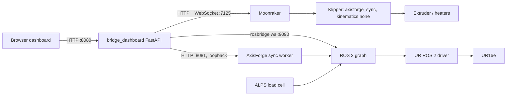

# Architecture

## Components

| Component | Host | Role |
| --- | --- | --- |
| `bridge_dashboard/app.py` | ROS/dashboard PC | FastAPI app, REST API, static UI |
| `moonraker.py`, `sync_clients.py` | ROS PC → Klipper | Moonraker HTTP/WebSocket clients (heartbeat and clock sampling use dedicated sockets) |
| `workflow.py` | ROS PC | Preflight and synchronized start/stop state machine |
| `preflight.py`, `gcode_check.py` | ROS PC | G-code validation, file-hash agreement, heater checks |
| `sync_start.py`, `orientation_index.py` | ROS PC | Arm/start/abort controller; live XYZ → ABC lookup |
| `rosbridge.py` | ROS PC | Robot topics/services via rosbridge |
| `robot_connection.py` | ROS PC | UR driver supervision and robot-ownership lock |
| `bed_probe.py`, `load_calibration.py` | ROS PC | Supervises native ALPS bed probe / scale calibration |
| `tcp_settings.py`, `clock_settings.py` | ROS PC | Nozzle TCP editor; clock timing profiles |
| `klipper_extras/axisforge_sync.py` | Klipper host | Immutable SHA-256 schedule master, lease and watchdog |
| `klipper_extras/axisforge_schedule.py`, `axisforge_corners.py` | Klipper host | Trapezoid scheduling, look-ahead, corner policies |
| `klipper_extras/robot_motion_bridge.py` | Klipper host | Optional read-only motion exporter (not used by the sync workflow) |
| AxisForge `axisforge_sync_worker` | ROS PC | Applies bed transform and TCP, IK, cubic joint interpolation, validates limits |

## Ownership

- **Klipper** owns the scalar progress profile u(t) shared by XYZ, ABC and
  nominal E, and applies pressure advance once. It runs no virtual-SD copy of
  the job.
- **The worker** keeps every master timestamp and rejects any violation of
  joint velocity/acceleration/position, orientation or branch continuity. Only
  the initial non-extruding approach may be retimed.
- **The Bridge** coordinates leases, clock mapping and aborts. Any fault stops
  both sides. The worker never publishes Portenta extrusion commands.

## Clock model

Bridge maps Klipper `print_time` to local monotonic time with five
request/response samples (smallest RTT; uncertainty = RTT/2 + 1 ms). Mapping is
refreshed before each run and drift is checked every 2 s. Bridge and worker must
share one Linux host clock. See [synchronized jobs](../synchronized-jobs.md).

## Safety interlocks

Fresh six-joint feedback, NORMAL safety mode, External Control running, speed
slider at 100%, Remote Control selected (dashboard Stop), cold-extrusion
protection, and a single robot owner (lock file) are enforced before Start.
