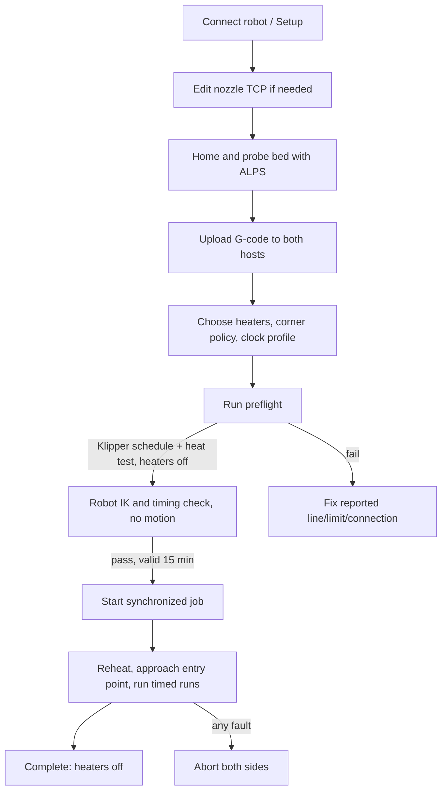

# Workflow

1. **Home & probe bed** whenever the surface is placed or moved. The ALPS load
   cell detects contact; the robot TCP supplies height. The nozzle must be
   upright, clean, below 50 °C, clear and unloaded; both heater targets zero.
2. **Upload to both** and select the file. The G-code contains A/B/C words;
   Klipper ignores them, the robot executes them.
3. **Run preflight.** Only selected heaters are heated, then set to zero before
   the robot checks. The result expires after 15 minutes, any file/config
   change, or a run.
4. **Start synchronized job.** Do not launch the file separately from
   Fluidd/Mainsail.
5. Stop uses the UR dashboard path (Remote Control required).

## Recovery

- A fault aborts both hosts; heaters go to zero. Fix the cause, run preflight
  again and restart from the beginning (no mid-job resume).
- If the UR program stops, restart External Control and re-run preflight.
- See [Troubleshooting](Troubleshooting.md) and the README section
  *Synchronized job recovery*.
